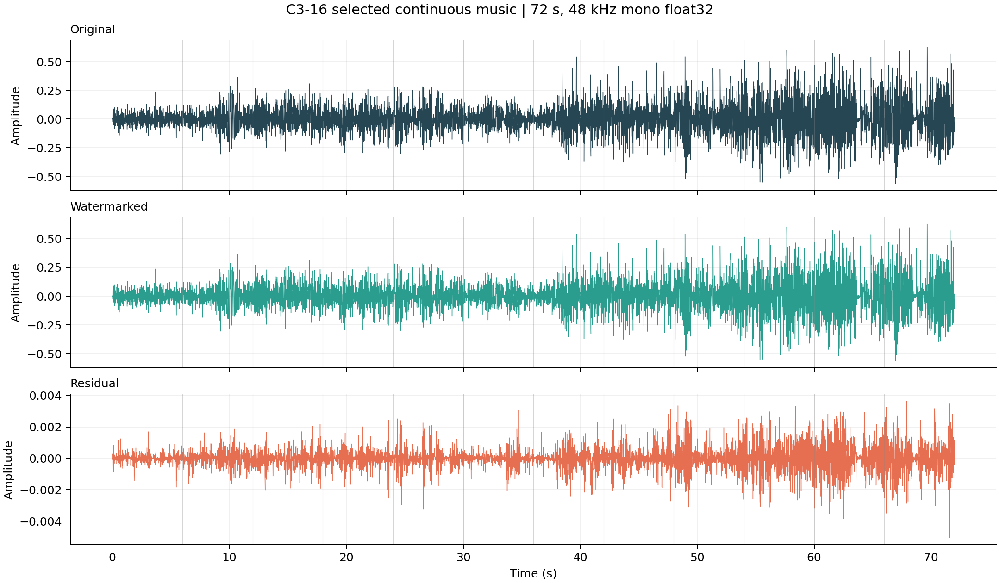
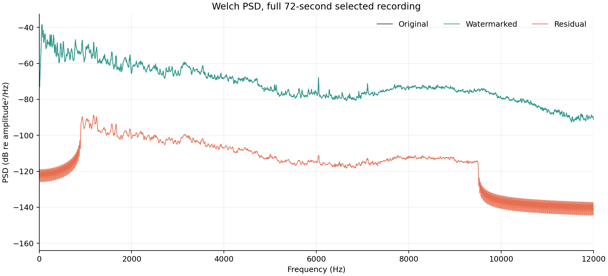
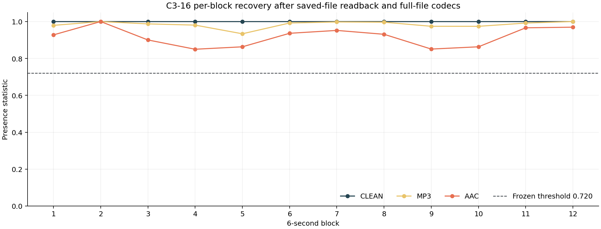

<div align="center">

# Audio Watermarking
### Reference-Assisted Multiband Watermarking for Digital Audio

**Embedding information into music, and recovering it after real-world audio processing.**

<br>


<br>

**[🌐 Interactive Project Website](https://shengkaini.com/blind-audio-watermarking/)** &nbsp;·&nbsp;
**[🎧 Real Music Listening](https://shengkaini.com/blind-audio-watermarking/#listen)** &nbsp;·&nbsp;
**[📊 Audio Processing Visuals](https://shengkaini.com/blind-audio-watermarking/#processing)** &nbsp;·&nbsp;
**[中文说明](README_ZH.md)**

</div>

---

## Overview

Audio watermarking adds a small digital message to a recording while preserving its primary purpose: **it should still sound like the original music**. File formats and metadata can change as audio is redistributed; signal-level information can sometimes survive those transformations.

This Digital Signal Processing course project implements a **reference-assisted, non-blind watermarking pipeline**. The sender distributes a watermarked recording; the receiver uses the matching **unwatermarked original** and a key to detect the hidden message. The detector is **not supplied the expected payload**.

The current course-final release offers two modes built around FFT-based multiband energy modulation and keyed across-frame message allocation:

| | **Robust Identity · C2** | **High Capacity · C3-16** |
| :-- | :-- | :-- |
| Six-second message | 8 bits | 16 bits |
| 72-second organization | Four ID bytes repeated three times | Twelve different 16-bit blocks |
| **Independent payload** | **32-bit identity** | **192-bit message** |
| Design priority | Redundant identity recovery | Higher information capacity |
| Detection | Original reference + key | Original reference + key |

> C2 transmits 96 coded bits across 72 seconds, but repeated copies contain only **32 independent information bits**. Neither C2 nor C3 is a blind detector, cryptographic authentication scheme, or arbitrary-song identification service.

## 🎧 Real Music Showcase

Our selected demonstration is **72 continuous seconds** from *Where You Are Now* by Benjamin Orth, featuring Wolf Fly. The showcase includes the actual original WAV, marked WAV and full-file MP3/AAC exports — not synthetic example sounds.

<div align="center">



*Figure 1 · Original music, embedded audio and the measured residual. The difference is shown separately because it is small relative to the host signal.*

</div>

**[▶ Listen: original / watermarked / MP3 / AAC](https://shengkaini.com/blind-audio-watermarking/#listen)** · **[Explore real codec and gain processing figures](https://shengkaini.com/blind-audio-watermarking/#processing)** · **[Browse the actual audio files](course_release/media/selected_c3_16_showcase/)**

In this **curated recording**, C3-16 carried twelve independent 16-bit blocks — **192 bits in 72 seconds** — and all 12 blocks were correctly recovered after Clean WAV readback, whole-file MP3 128 kbps and AAC-LC 128 kbps processing. The measured embedding SNR was **45.0 dB**. No formal listening-panel evaluation was conducted.

Further operations on this same selected audio — **MP3→AAC**, **−6 dB**, **+3 dB** and **48→44.1→48 kHz resampling** — also retained the complete message. These observations do not establish general robustness across every source recording.

## How It Works

```text
                  EMBEDDING
   Original audio + Message + Key
                  |
        6 s blocks / FFT frames
                  |
      Keyed bit-to-chip allocation
                  |
    Paired-band energy modulation
                  |
           Watermarked WAV
                  |
      MP3 / AAC / gain / resample
                  |
                  v
                  DETECTION
   Received audio + Reference + Key
                  |
   Time alignment / spectral difference
                  |
     Chip aggregation / bit decisions
                  |
       Presence & consistency gate
                  |
      Recovered message / UNKNOWN
```

The **reference-assisted spectral difference** is the central receiver operation: the detector compares relative band energies of the received recording and matching original, then aggregates the keyed chip contributions to estimate message bits.

<div align="center">



*Figure 2 · Measured spectral comparison from the selected music. The algorithm modulates relative energy over three band pairs instead of replacing an isolated FFT coefficient.*



*Figure 3 · Actual message recovery across the twelve six-second blocks of the 192-bit demonstration.*

</div>

## Experimental Evidence

Results are reported under their **own evaluation protocols**; they should not be merged into a single headline percentage.

| Protocol | Clean | MP3 128 kbps | AAC-LC 128 kbps |
| :-- | --: | --: | --: |
| **C2** · 60-source locked test, 8-bit blocks | 60/60 | 59/60 | 57/60 |
| **C3-16** · 120-source independent test, 16-bit blocks | 120/120 | 120/120 | 103/120 |
| **C3-16** · one selected 72-second recording, blocks | 12/12 | 12/12 | 12/12 |

The table counts **correctly accepted** messages/blocks. In the C3 independent AAC evaluation, **11/120 wrong messages were accepted** and **6/120 were UNKNOWN**. An additional ten-file, mixed-source development study recovered the entire 192-bit message in **2/10 AAC files** and **6/10 MP3→AAC files**. The selected music should not be read as a general AAC success rate.

The **C2 repeated 32-bit ID** was separately recovered in **20/20** mixed 72-second recordings under each of Clean, MP3 and AAC. This lower-capacity identity task has a different success criterion than recovering 192 independent bits.

For the exact experimental conditions, negative trials and limitations, see **[Frozen Evidence Summary](course_release/EVIDENCE_SUMMARY.md)**.

## Reproduce the Course Release

The publishable C2/C3 package lives under **[`course_release/`](course_release/)**; legacy code remains in its original locations to avoid disrupting the historical V3 online demonstration.

**Dependencies:** Python ≥3.10, NumPy, SciPy, and separately installed FFmpeg for real MP3/AAC round trips.

```bash
git clone https://github.com/suibianba12138/blind-audio-watermarking.git
cd blind-audio-watermarking/course_release

python -m venv .venv
source .venv/bin/activate
python -m pip install -e '.[test]'
python -m pytest -q
```

A 6-second C3-16 run with a **public demo key**:

```bash
python examples/embed_detect_6s.py \
  --mode c3-16 \
  --reference media/selected_c3_16_showcase/Original.wav \
  --message A7C3 \
  --key course-demo-public-v1 \
  --output /tmp/c3-marked.wav
```

The example embeds into a real music block, writes WAV, reads it back and independently detects with a reference. For full 72-second modes, see [C2 Long-ID / C3-192 scripts](course_release/README.md). The **public key is intentionally different** from the frozen evaluation key, so historical showcase scores are **not** reproducible by re-detecting published watermarked files with the public key.

## Repository & Version History

| Directory | Purpose |
| :-- | :-- |
| **[`course_release/`](course_release/)** | **Current course-final C2/C3** source, runnable examples, tests, licensed music, figures |
| **[`archive/`](archive/)** | Historical version notes, original README snapshots and preserved branch links |
| [`src/`](src/) / [`app/`](app/) | Historical V3/legacy program, maintained for compatibility |
| [`docs/`](docs/) | Earlier course documentation and historical static-site material |

The development history is preserved, not rewritten:

**[V2 — four-label identity watermark](archive/v2/README.md)** · **[V3 — blind FFT/QIM + Soft-Code](archive/v3/README.md)** · **[V4 — pretrained neural blind-watermark Studio](archive/v4/README.md)**

V4's third-party **Sony SilentCipher** pretrained model is not part of this reference-assisted C2/C3 release. The existing [Render demo](https://blind-audio-watermarking-demo.onrender.com/) is **historical V3**, not a C2/C3 online inference service. The [current showcase website](https://shengkaini.com/blind-audio-watermarking/) is an **interactive visualization with real recorded media**, not a live embedding or detection engine.

## License, Attribution & Scope

Course code is MIT-licensed; music has separate **CC BY 3.0** attribution. The selected track is *Where You Are Now* by Benjamin Orth (featuring Wolf Fly), [source page](https://www.ccmixter.org/files/Benjamin_Orth/33036); the 72-second version has been downmixed, resampled, cropped, watermarked and encoded. See [third-party notices](course_release/THIRD_PARTY_NOTICES.md) and [source provenance](course_release/SOURCE_PROVENANCE.json).

The detector assumes the matching original reference and substantially aligned material. Arbitrary clipping, deliberate removal/forgery, source discovery and cryptographic proof of copyright have **not** been established.

---

<div align="center"><sub>Audio Watermarking · Digital Signal Processing Course Project · 2026 · Original audio → Watermarked audio → Real processing → Reference-assisted recovery</sub></div>
