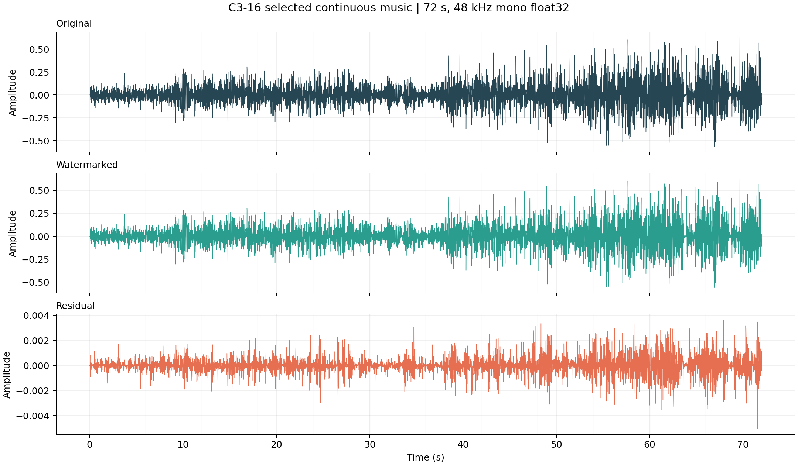
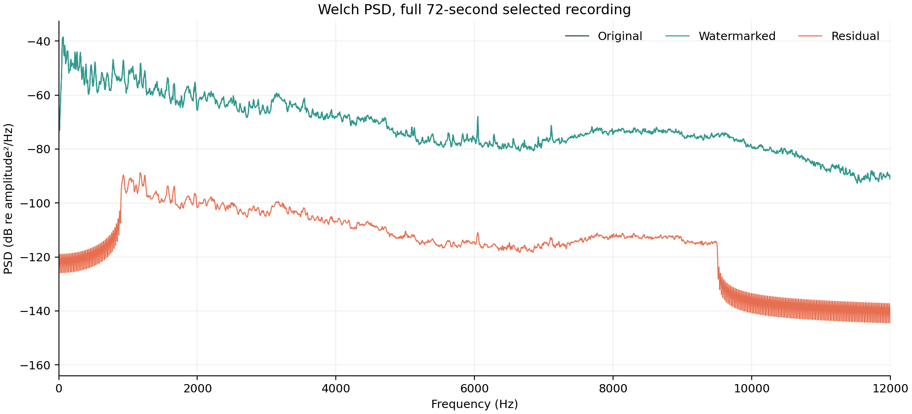
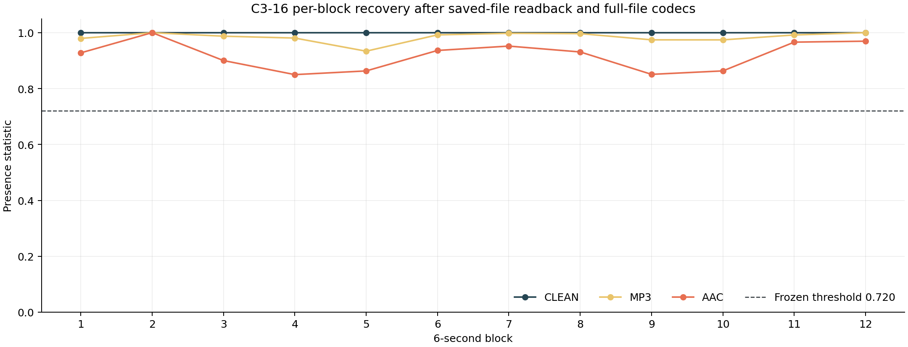

<div align="center">

# 数字音频水印系统
### Reference-Assisted Multiband Audio Watermarking

**让信息留在声音里：真实音乐中的嵌入、信号处理与可靠恢复。**

<br>


<br>

**[🌐 项目展示网站](https://shengkaini.com/blind-audio-watermarking/)** &nbsp;·&nbsp;
**[🎧 真实音乐试听](https://shengkaini.com/blind-audio-watermarking/#listen)** &nbsp;·&nbsp;
**[📊 信号处理可视化](https://shengkaini.com/blind-audio-watermarking/#processing)** &nbsp;·&nbsp;
**[English README](README.md)**

</div>

---

## Overview｜项目简介

我们希望在不明显影响正常听音体验的条件下，让一段真实音乐携带额外的数字信息，并尝试在 MP3、AAC、音量变化与重采样后恢复它。

本项目是电子科技大学**数字信号处理课程设计**：基于分帧 FFT、多频带相对能量调制、密钥驱动的跨帧 chip 分配和参考辅助统计检测，实现了两种不同侧重的数字音频水印模式。

> **检测前提：** 接收端需要对应的**无水印原始音频**和密钥，但不会提前获得目标消息。C2/C3 均为**参考辅助、非盲水印**。该系统用于受控分发场景及 DSP 课程演示，并非版权真实性认证工具。

### 两种模式

| | **高可靠身份 · C2** | **高容量消息 · C3-16** |
| :-- | :-- | :-- |
| 每 6 秒载荷 | 8 bit | 16 bit |
| 72 秒布局 | 一个 32-bit ID 拆为 4 字节，重复 3 轮 | 12 个不同的 16-bit 消息块 |
| **独立信息量** | **32 bit** | **192 bit** |
| 侧重点 | 通过冗余提高身份恢复可靠性 | 提高连续音频中的信息容量 |
| 检测条件 | 原音参考 + 密钥 | 原音参考 + 密钥 |

**注意：** C2 的 72 秒共发送 96 bit 编码数据，但独立的身份信息只有 **32 bit**，不能将二者混淆。

## 🎧 真实音乐展示

我们选取了 *Where You Are Now*（Benjamin Orth，featuring Wolf Fly）的连续 **72 秒音乐**，完成水印嵌入、整段真实编解码及检测。仓库公开了原音 WAV、水印 WAV、MP3、AAC 与配套图表。

<div align="center">



*图 1 · 原音、水印音及实际残差。由于改变量较小，残差需要单独显示。*

</div>

**[▶ 试听原音 / 水印音 / MP3 / AAC](https://shengkaini.com/blind-audio-watermarking/#listen)** · **[查看重复转码与重采样图像](https://shengkaini.com/blind-audio-watermarking/#processing)** · **[浏览音频文件](course_release/media/selected_c3_16_showcase/)**

在这首**精选案例**中，C3-16 在 72 秒内嵌入 12 组不同的 16-bit 消息，合计 **192 bit**；Clean WAV、整段 MP3 128 kbps、AAC-LC 128 kbps 均实现 **12/12 块正确恢复**。嵌入 SNR 约 **45.0 dB**，但未进行正式的主观听音实验。

同一份音乐还经过 **MP3→AAC、−6 dB、+3 dB、48→44.1→48 kHz 重采样**，在这些处理下完整消息仍可恢复。这是**精选音源的演示结果**，不代表任意音频均具有同样表现。

## How It Works｜算法实现

```text
                 嵌入端
        原音 + 数字消息 + 密钥
                  │
             分帧 / FFT
                  │
         密钥控制的 chip 分配
                  │
         三组频带对能量调制
                  │
            水印 WAV 音频
                  │
     MP3 / AAC / 音量 / 重采样
                  │
                  ▼
                 检测端
        接收音 + 原音参考 + 密钥
                  │
          时间对齐 / 频带差分
                  │
          chip 聚合 / bit 判决
                  │
          水印存在性统计检查
                  │
           恢复消息 / UNKNOWN
```

关键不在于修改某一个频谱点，而是**通过频带对之间的相对能量传递信息**。不同消息位由密钥分散到多个 FFT 帧；接收端借助原音参考抑制宿主信号影响，并统计聚合多帧信息。

<div align="center">



*图 2 · 真实音乐的频谱比较：频带调制比直接替换单个 FFT 系数更适合本项目的设计。*



*图 3 · 精选 72 秒音乐中的 12 个消息块及实际恢复结果。*

</div>

## 📊 实验验证

不同模式采用不同容量和实验协议，下表中的数值均表示**正确接受的消息数 / 测试数**，不能直接合并为一个总成功率。

| 测试 | Clean | MP3 128 kbps | AAC-LC 128 kbps |
| :-- | --: | --: | --: |
| **C2** · 60 条独立音源，8-bit / 6 秒 | 60/60 | 59/60 | 57/60 |
| **C3-16** · 120 条独立音源，16-bit / 6 秒 | 120/120 | 120/120 | 103/120 |
| **C3-16** · 精选 72 秒音乐，逐块 | 12/12 | 12/12 | 12/12 |

C3-16 的独立 AAC 测试中，另有 **11/120 个错误消息被接受**、6/120 返回 UNKNOWN；在单独的 10 条随机混合 72 秒开发测试里，AAC 完整 192-bit 恢复为 **2/10**，MP3→AAC 为 **6/10**。因此不能把精选音乐的 12/12 描述为普遍的 AAC 鲁棒性。

C2 的 **32-bit 重复身份模式**另在 20 条 72 秒随机混合音频上进行验证，Clean、MP3、AAC 各为 **20/20 完整身份恢复**。其信息量和成功标准与 C3 的 192-bit 完整消息不同。

更多测试协议、负样本和误接受细节见 **[冻结实验依据](course_release/EVIDENCE_SUMMARY.md)**。

## 🚀 运行课程最终版

**运行环境：** Python ≥ 3.10、NumPy、SciPy；使用 MP3/AAC 实际编解码需另行安装 FFmpeg。

```bash
git clone https://github.com/suibianba12138/blind-audio-watermarking.git
cd blind-audio-watermarking/course_release
python -m venv .venv
source .venv/bin/activate
python -m pip install -e '.[test]'
python -m pytest -q
```

用公开 Demo Key 在真实音乐的前 6 秒嵌入并检测 16-bit 消息：

```bash
python examples/embed_detect_6s.py \
  --mode c3-16 \
  --reference media/selected_c3_16_showcase/Original.wav \
  --message A7C3 \
  --key course-demo-public-v1 \
  --output /tmp/c3-marked.wav
```

更多 [72 秒 C2 Long-ID / C3-192 和 FFmpeg 使用示例](course_release/README_ZH.md)。**公开 Demo Key 不同于冻结测试的密钥**，不能拿它直接检测历史水印文件并声称复现原有成绩。

## 📂 仓库导航与历史版本

| 路径 | 内容 |
| :-- | :-- |
| **[`course_release/`](course_release/)** | 当前 C2/C3 最终版源码、示例、测试、授权音乐与图表 |
| **[`archive/`](archive/)** | V2/V3/V4 历史归档、旧 README 快照及对应代码分支 |
| [`src/`](src/) / [`app/`](app/) | 历史 V3 代码，保留原路径确保旧演示兼容 |
| [`docs/`](docs/) | 历史课程文档与旧网站素材 |

**[V2 · 四身份水印](archive/v2/README.md)** · **[V3 · FFT/QIM 盲水印](archive/v3/README.md)** · **[V4 · SilentCipher 神经盲水印 Studio](archive/v4/README.md)**

V4 使用的 Sony SilentCipher 属于**第三方预训练模型**，与最终 C2/C3 参考辅助 DSP 水印不同。现有 [Render 在线演示](https://blind-audio-watermarking-demo.onrender.com/) 属于**历史 V3**；当前 [项目网站](https://shengkaini.com/blind-audio-watermarking/) 为真实音频与已保存实验的交互式展示页，**不会在线运行新的嵌入和检测计算**。

## 📜 许可与适用边界

课程源码使用 MIT 许可；演示音乐为单独的 **CC BY 3.0**，并非 MIT。音乐 *Where You Are Now* 由 Benjamin Orth 创作（featuring Wolf Fly），原曲见 [ccMixter](https://www.ccmixter.org/files/Benjamin_Orth/33036)；展示使用的 72 秒片段经过声道混合、重采样、截取、水印嵌入和编码。更多信息见 [第三方素材说明](course_release/THIRD_PARTY_NOTICES.md) 与 [源码溯源](course_release/SOURCE_PROVENANCE.json)。

本系统依赖匹配原音参考，不保证任意裁剪、主动去水印攻击、未知歌曲检索或版权真实性的密码学证明。

---

<div align="center"><sub>Digital Audio Watermarking · UESTC DSP Course Project · 2026 · Reference-Assisted Multiband Modulation</sub></div>
